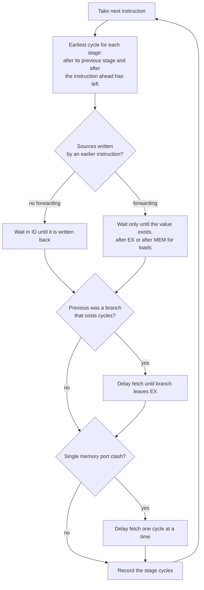

# Pipeline Execution Simulator

Computer Organization and Architecture (SY CSE), CO5 micro project. Department of Integrated B.Tech, Sanjivani University, Kopargaon.

Topic from the notice: **4. Pipeline execution (stages, hazards, stalls)**

| Name | PRN |
|---|---|
| [Student 1 name - fill in] | [PRN] |
| [Student 2 name - fill in] | [PRN] |


> The names and PRNs above are placeholders. Replace them here and in the header of `index.html` (search for `[Student 1 name]`) before you submit.

## What it does

You enter a short instruction trace, pick the pipeline settings, and the simulator draws the classic pipeline diagram: one row per instruction, one column per clock cycle, each cell showing the stage that instruction is in. Stalls, flushes and waiting bubbles are marked, and the page lists every hazard it found with an explanation. Step forward and back one cycle at a time to see which instruction is in which stage right now.

## Pipeline models

| Stages | Names | Notes |
|---|---|---|
| 5 | IF, ID, EX, MEM, WB | the textbook pipeline |
| 4 | IF, ID, EX, WB | memory access is part of EX |
| 3 | IF, ID, EX | EX also does memory access and write back |

## Hazards covered

* **Data hazards (RAW).** An instruction needs a register that an earlier one has not written yet. Without forwarding it waits in ID until the earlier instruction has written back. With forwarding the value is passed along as soon as it exists: after EX for arithmetic results, after MEM for loads. That is why a load followed straight away by an instruction that uses the loaded value still costs one stall even with forwarding.
* **Control hazards.** The branch outcome is known at the end of EX. With **stall** handling the next instruction is not fetched until then. With **predict not taken** fetching just continues, and only a *taken* branch costs cycles (the wrongly fetched instructions are flushed).
* **Structural hazard** (switch on *single memory port*). Instruction fetch and data access share one memory, so a fetch that falls in the same cycle as a load or store's memory access has to wait one cycle.



## Numbers shown

* **Total cycles** and **cycles with no stalls** (instructions + stages - 1).
* **Stall cycles**, split into data, branch and memory-port stalls. Total cycles always equals the no-stall figure plus the stall cycles. The tests check this on thousands of random programs.
* **CPI** = total cycles / instructions.
* **Speed-up vs no pipeline** = (instructions x stages) / total cycles.

## Instruction trace format

One instruction per line, in the order they actually execute:

```
ADD R1, R2, R3        ; also SUB AND OR SLT
ADDI R1, R2, 5
LW  R1, 0(R2)
SW  R1, 4(R2)
BEQ R1, R2, T         ; T = taken, NT = not taken  (BNE works the same way)
NOP
```

Registers are R0 to R31. R0 is always zero, so it never causes a dependency. `;` or `#` starts a comment.

Because the trace is the order of execution, there are no labels or jump targets: when a branch is marked `T`, the next line is simply the instruction at the target.

## Good experiments

* *Data hazard chain* with forwarding **off** and then **on**: 11 cycles become 9.
* *Load-use hazard* with forwarding on: one stall remains, and the page says why.
* *Branch taken, then not taken* with **stall** vs **predict not taken**.
* Change the number of stages and watch the ideal cycle count and the hazard behaviour change.

## Files

```
index.html               page layout
style.css                styling
pipeline.js              parser and cycle scheduler (no browser code in it)
app.js                   diagram, statistics and controls
tests/pipeline.test.js   automatic checks
```

## Questions you may be asked, with short answers

**Why does a pipeline improve throughput but not the time for one instruction?** One instruction still passes through every stage. The gain is that a new instruction can start every cycle.

**What is a stall?** A bubble inserted because an instruction cannot move forward yet, usually waiting for data.

**What does forwarding do?** It routes a result from the pipeline register where it was just produced straight to the input of the ALU, instead of waiting for it to go through WB and the register file.

**Why can forwarding not fix load-use?** A load only has its data after the MEM stage, which is too late for the very next instruction's EX.

**Why does predict-not-taken cost nothing sometimes?** When the guess is right the pipeline already fetched the correct instructions.

**What is the speed-up limit?** About the number of stages, reached only when there are no stalls and the program is long.

## Assumptions

The register file is written in the first half of a cycle and read in the second half, so a value written in WB can be read by an instruction in ID in the same cycle. Branches resolve at the end of EX. A store only needs the register it stores when it reaches MEM. Instruction fetch and memory access cost one cycle each (no cache misses).
## Running it on your own computer

Open `index.html` in any modern browser. Nothing has to be installed and nothing is uploaded anywhere. If your browser blocks something when opening the file directly, run `python3 -m http.server` inside this folder and open `http://localhost:8000`.

To run the automated checks you need Node.js (version 16 or newer): `node tests/pipeline.test.js`

## Putting it on GitHub

1. Create a new **public** repository on github.com (for example `coa-pipeline-execution`). Do not tick "Add a README", you already have one.
2. Upload everything in this folder: on the empty repository page choose **uploading an existing file**, drag all the files and the `tests` folder in, and commit. (Or use `git init`, `git add .`, `git commit`, `git remote add origin ...`, `git push -u origin main` from this folder.)
3. In the repository go to **Settings, then Pages**. Under *Build and deployment* set **Source** to *Deploy from a branch*, pick the `main` branch and the `/ (root)` folder, and save.
4. After a minute or two the simulator is live at `https://<your-github-username>.github.io/coa-pipeline-execution/`. Put that link at the top of this README and in the Google Form.

GitHub's menu labels change from time to time, so if a name above does not match, look for the Pages section under Settings.
